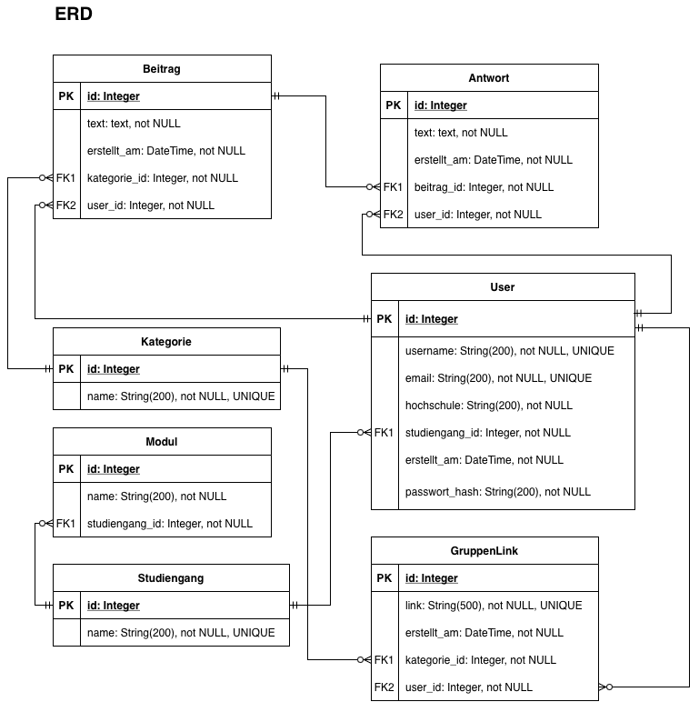

[← Documentation Home](README.md)

# Data Model

## Overview

Das Datenmodell von Yuni bildet die Grundlage für den Informationsaustausch und die Vernetzung von Studierenden. In der Datenbank werden Benutzerkonten, Studiengänge, Module, Kategorien, Beiträge, Antworten und Gruppenlinks gespeichert.

Studierende können Fragen stellen, Informationen austauschen, auf Beiträge anderer Studierender antworten und Links zu relevanten Gruppen teilen. Dabei können sie sowohl als Informationssuchende als auch als Informationsanbieter auftreten.

## Entity-Relationship Diagram

Das folgende Entity-Relationship-Diagramm (ERD) visualisiert die Struktur der Datenbank und stellt die Entitäten, ihre Attribute, Primär- und Fremdschlüssel sowie die Beziehungen zwischen den Entitäten dar.

## Entities and Relationships

Die **Entität User** repräsentiert die registrierten Studierenden. Da alle Studierenden sowohl Informationen suchen als auch bereitstellen können, wird im Datenmodell nicht zwischen zwei festen Benutzerrollen unterschieden.

Die **Entitäten Beitrag und Antwort** ermöglichen den gegenseitigen Informationsaustausch. Studierende können eigene Beiträge erstellen und auf Beiträge anderer Studierender antworten.

Die **Entität Kategorie** dient der thematischen Zuordnung von Beiträgen und Gruppenlinks, um das Auffinden relevanter Informationen zu erleichtern.

Über die **Entität GruppenLink** können Studierende Links zu externen Gruppen bereitstellen und dadurch die Vernetzung untereinander fördern.

Die **Entitäten Studiengang und Modul** bilden die akademische Struktur ab. Sie ermöglichen die Zuordnung von Studierenden und Modulen zu den jeweiligen Studiengängen.

## Related Design Decisions

[Link to the Design Decisions that explain important choices in your data model, such as the representation of user roles, relationships between entities, or data integrity constraints. Keep the rationale in those documents rather than duplicating it here. Use relative links for referencing, like so:

- [01: How to access the database - SQL or SQLAlchemy](design-decisions/dd-01.md)

[**Important:** The documented data model, including related Design Decisions, must reflect your app's actual implementation.]
