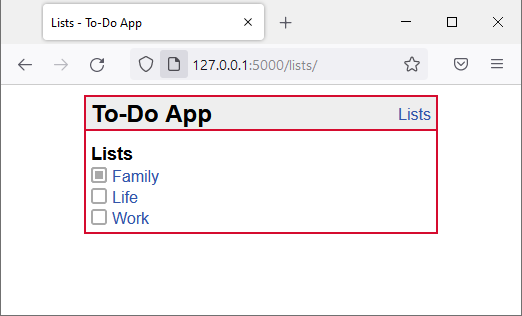

> [!IMPORTANT]
> Any text enclosed by `[ ]` are **placeholders**, including the opening and closing brackets.
>
> You may delete this `!IMPORTANT` box.

# [YUNI]

**Yuni** ist eine Web-App von Studierenden für Studierende der HWR Berlin. Sie verbindet Studierende, die Unterstützung im Studium suchen mit anderen Studierenden, die ihr Wissen und ihre Erfahrungen weitergeben möchten. 

Yuni bündelt 3 Bereiche auf einer Plattform:

- **Nachhilfe**: Studierende können Nachhilfeangebote veröffentlichen oder passende Angebote finden.
- **Studien-Guides**: Orientierungshilfen für verschiedene Studienphasen (Praktikum, Klausurphasen, Bachelorarbeit etc.)
- **Community**: Ein Forum für Erfahrungsaustausch und Fragen sowie eine Übersicht von Einladungslinks für relevante WhatsApp-Gruppen. 

[Include a short project description. Below, include a representative, attractive screenshot of your final web app.]

---

## Documentation Contents

- [Value Proposition](01-value-proposition.md)
- [Data Model](02-data-model.md)
- [Design Decisions](design-decisions/README.md)
- [Product Discovery](product-discovery/README.md)
- [Contributors](contributors/README.md)

---

## Refinements since Submission

[List (a) which refinements or improvements you have promised during Oral Examination and (b) to which extent you managed to implement them with the Refined Submission (and reasons for deviations, if any).]
